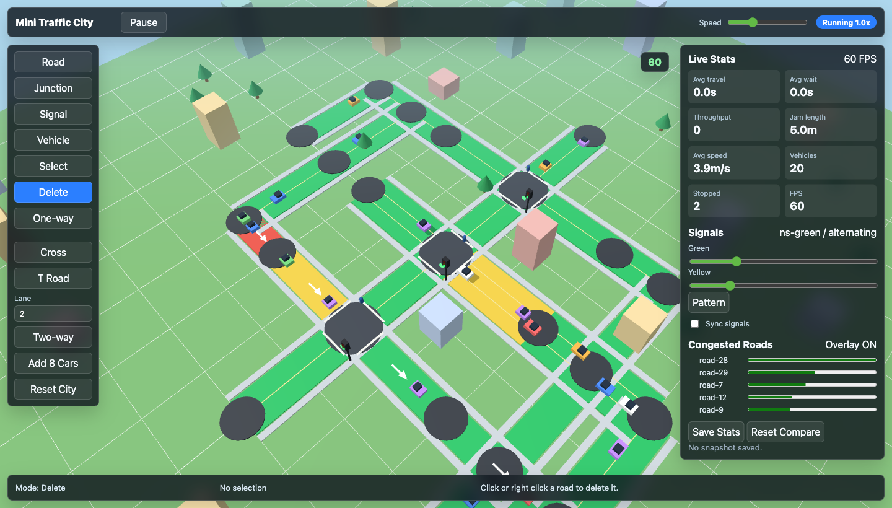

# Mini Traffic City Simulator



three.js で動く、ブラウザ向けのミニ交通都市シミュレーターです。小さな 3D 都市マップ上で道路、交差点、信号、車両、歩行者、混雑状況、統計値を観察・調整できます。外部サーバーを使わない静的 Web アプリとして実装しています。

GitHub Pages: https://sudoyan118.github.io/mini-traffic-city-sim/

## 主な機能

- グリッド上の直線道路配置、十字路プリセット、T 字路プリセット
- 自動交差点判定、一方通行/双方向切替、1〜3 車線変更、道路削除
- 道路ネットワーク上を自動走行する車両、交差点での進路変更、停止/再発進
- 交差点ごとの信号、青/黄/赤の周期切替、南北/東西の交互制御、信号周期調整
- 車両密度、平均速度、停止台数にもとづく混雑可視化
- 平均移動時間、平均待ち時間、通過台数、渋滞長、平均速度、車両数、停止台数、FPS の表示
- 統計スナップショット保存と、設定変更後の改善/悪化比較
- ミニチュア都市風の建物、歩道、街路樹、横断歩道、信号機、車両、歩行者

## 操作方法

- `WASD` / 矢印キー: カメラ移動
- マウスドラッグ: 選択モードでカメラ回転
- ホイール: ズーム
- 左クリック: 現在モードに応じて配置/選択/編集
- 右クリック: 近い道路を削除
- `1`: 道路配置
- `2`: 交差点配置
- `3`: 信号配置
- `4`: 車両追加
- `5`: 選択/編集
- `Space`: 一時停止/再開
- `R`: カメラリセット
- `C`: 混雑表示 ON/OFF
- `Tab`: 統計パネル表示切替

画面左側の編集ツールバーと右側の統計パネルの詳しい使い方は [UI Guide](docs/UI_GUIDE.md) にまとめています。

初回の開発要求プロンプトは、公開用に機密情報を含まない形で [INITIAL_PROMPT.txt](docs/INITIAL_PROMPT.txt) に保存しています。

## ローカル起動

```bash
npm install
npm run dev
```

Vite の `base` は `/mini-traffic-city-sim/` に設定しているため、GitHub Pages のサブパス公開でもアセット参照が壊れない構成です。

## CI/CD

`.github/workflows/pages.yml` が `main` ブランチへの push を契機に以下を実行します。

- Node.js 20 のセットアップ
- `npm ci`
- `npm run build`
- `actions/configure-pages`
- `actions/upload-pages-artifact`
- `actions/deploy-pages`

## QA

QA inventory は [QA_INVENTORY.md](QA_INVENTORY.md) に整理しています。

ローカル Playwright で確認した主な項目:

- 初期表示、サンプル都市、車両走行、信号相変化、統計更新
- 道路追加、十字路追加、T 字路追加、信号追加、車両追加
- 一方通行切替、車線数変更、道路削除
- 停止車両、再発進、道路セグメント遷移
- 混雑表示 ON/OFF、緑/黄/赤の混雑レベル
- 統計保存、比較表示、Pause/Resume、Tab、カメラ操作、ズーム、リサイズ

スクリーンショット:

- `docs/header.png`
- `output/playwright/local-initial.png`
- `output/playwright/local-after-functional.png`
- `output/playwright/local-congestion-clean.png`
- `output/playwright/local-portrait.png`
- `output/playwright/local-wide.png`
